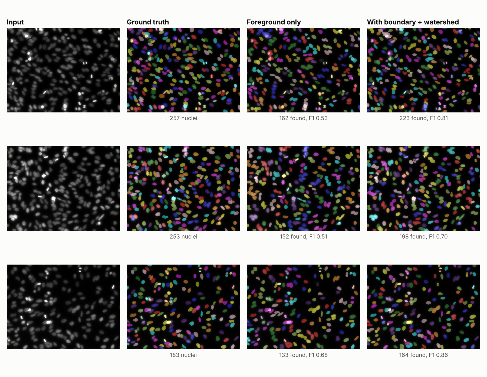

# Computer vision projects

[](https://github.com/abelmamo/computer-vision-projects/actions/workflows/tests.yml)

Five computer vision projects in PyTorch, from a CNN trained from scratch to a
nucleus instance segmentation pipeline for microscopy. Each folder has its own
README with setup, training and inference commands, and the three trained
projects include their measured results in a `results/` folder.

| Project | Task | Approach | Result |
|---|---|---|---|
| [`biomedical-cell-segmentation`](./biomedical-cell-segmentation) | Nucleus instance segmentation | U-Net predicting foreground + boundary maps, watershed splitting, per-nucleus morphology export | F1 0.809 at IoU 0.5 on 50 held-out DSB2018 images (0.731 without the boundary map) |
| [`image-classifier`](./image-classifier) | Image classification | CNN trained from scratch on CIFAR-10 | 80.8% test accuracy |
| [`object-detection`](./object-detection) | Object detection | YOLOv8n fine-tuned with Ultralytics | mAP50 0.994 on the medical-pills validation set |
| [`image-segmentation`](./image-segmentation) | Binary semantic segmentation | U-Net trained from scratch | Code only |
| [`face-detection-recognition`](./face-detection-recognition) | Face detection + recognition | OpenCV Haar cascade + `face_recognition` embeddings | Code only |



## How the results were produced

All numbers come from the scripts in this repository, run on CPU with a fixed
seed (`--seed 0`). Test sets are used only for reporting, never for choosing
a checkpoint or a setting. The pill dataset has no test split, so that project
reports validation numbers. Each project's README lists the exact commands,
and its `results/` folder holds the metrics file, training log and figures.

## Tests

`tests/` has fast CPU checks with synthetic data: model output shapes, the
foreground and boundary targets built from instance labels, the watershed
split of touching nuclei, the filtering of small seed fragments, and the IoU
matching used for evaluation. They run on every push through GitHub Actions.

```bash
pip install torch torchvision scikit-image scipy pillow numpy matplotlib pytest
pytest -q tests
```
