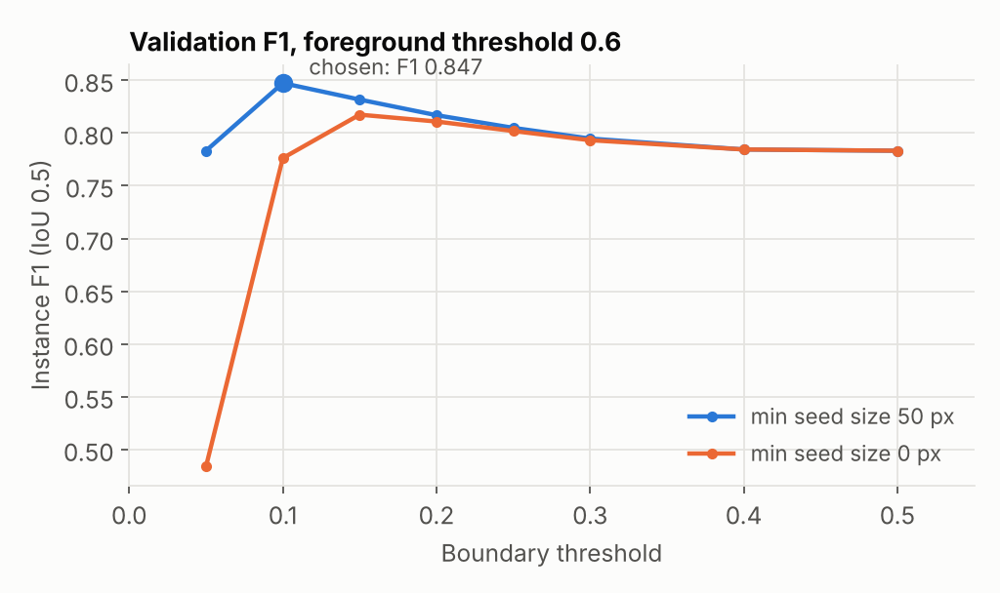
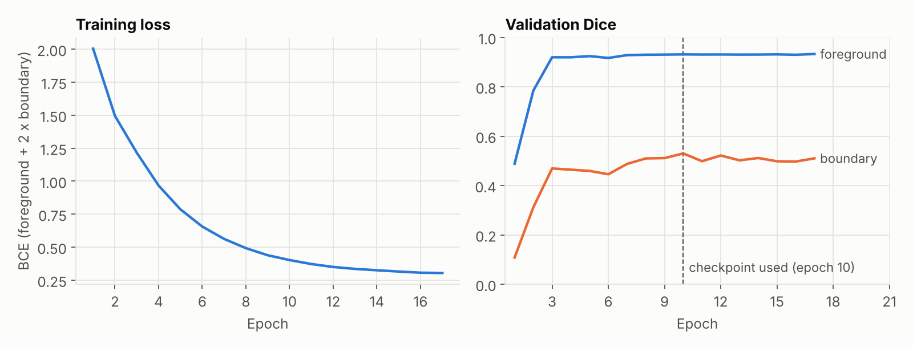

# Nucleus Instance Segmentation for Microscopy

Finds and separates every nucleus in a fluorescence microscopy image, then
measures each one (area, centroid, eccentricity, mean intensity). Counting
and measuring individual nuclei is a basic step in quantitative biology, and
it needs instances, not just a foreground mask: touching nuclei have to be
split apart.

## Results

Tested on the 50 held-out test images (2,460 nuclei) of the DSB2018 subset
released with StarDist. A predicted nucleus counts as correct if it overlaps a
ground-truth nucleus with IoU above 0.5.

| Method | Precision | Recall | F1 |
|---|---|---|---|
| Foreground mask only (connected components) | 0.800 | 0.672 | 0.731 |
| Foreground + boundary maps, watershed (this pipeline) | **0.829** | **0.790** | **0.809** |

Both rows use the same trained network. The only difference is whether the
boundary channel is used to split touching nuclei, so the gap measures what
that step adds: recall goes up by 0.12, because merged blobs are now
separated into the nuclei they contain. Pixel-level foreground Dice is 0.926,
and the predicted nucleus count is off by 5.4 per image on average (images
hold 49 nuclei on average).


The three most crowded test images. The foreground-only method merges
neighbors into single objects (F1 0.51 to 0.68). The full pipeline separates
most of them (F1 0.70 to 0.86).

## How it works

1. **Two outputs instead of one.** The U-Net (`unet.py`) predicts a
   foreground map (is this pixel inside any nucleus) and a boundary map (is
   this pixel on the border of a nucleus, including the border between two
   touching ones). `dataset.py` builds both targets from instance labels.
2. **Seeds.** Pixels that are foreground and not boundary are the confident
   interior of each nucleus. Each connected group of them is one seed.
3. **Watershed.** Seeds grow outward over the foreground, so each pixel of a
   merged blob is assigned to the nearest seed.
4. **Measurement.** `segment.py` writes one CSV row per nucleus.

## Choosing the post-processing thresholds

The boundary target is the ring just outside each nucleus, so inside a merged
blob the network's boundary probability is usually well below 0.5. With the
default 0.5 threshold the watershed finds too few seeds and rarely splits
anything (validation F1 0.771). Lowering the threshold creates the missing
seeds, but also small spurious fragments, so seeds below a minimum size are
dropped.

`tune.py` searches 144 settings on the 67 validation images that training
held out, never on the test set:

- foreground threshold: 0.4, 0.5, 0.6
- boundary threshold: 0.05 to 0.5
- minimum seed size: 0 to 50 pixels



The chosen setting (foreground 0.6, boundary 0.1, minimum seed 50 px) reaches
validation F1 0.847. With the boundary threshold at 0.1, every combination of
foreground 0.4 to 0.6 and seed size 20 to 50 px scores between 0.841 and
0.847, so the result does not depend on one lucky value. Without the minimum seed size (orange), a low boundary
threshold breaks nuclei into fragments and F1 drops to 0.48.

## Training



| Setting | Value |
|---|---|
| Data | 447 training images, split 380 / 67 for training / validation (seed 0) |
| Input | Grayscale, percentile-normalized, resized to 256 x 256 |
| Augmentation | Random 90-degree rotations and horizontal flips |
| Loss | BCE on foreground + 2 x BCE on boundary (boundary pixels are rare) |
| Optimizer | Adam, learning rate 5e-4, cosine schedule, batch size 8 |
| Hardware | CPU, about 5.5 minutes per epoch on 2 cores |

The run was planned for 20 epochs and stopped after 17. Validation Dice had
stopped improving after epoch 10, and the checkpoint used everywhere above is
the one with the best validation score (epoch 10).

## Setup

```bash
pip install -r requirements.txt
```

## Data

Any of two layouts works (see `dataset.py`):

```
# one label image per sample (StarDist DSB2018 subset)
dataset/images/<name>.tif
dataset/masks/<name>.tif          0 = background, k = k-th nucleus

# one binary mask per nucleus (Kaggle 2018 Data Science Bowl)
dataset/<sample_id>/images/<sample_id>.png
dataset/<sample_id>/masks/<instance>.png
```

The reported results use
[`dsb2018.zip`](https://github.com/stardist/stardist/releases/download/0.1.0/dsb2018.zip)
from StarDist ([Schmidt et al., 2018](https://arxiv.org/abs/1806.03535)), a
curated subset of the Kaggle 2018 Data Science Bowl `stage1_train` images.

## Reproduce the results

```bash
python train.py --data-dir dsb2018/train --img-size 256 --epochs 20 \
    --batch-size 8 --lr 5e-4 --seed 0 --log results/training_log.csv
python tune.py --data-dir dsb2018/train --checkpoint nuclei_unet.pt
python evaluate.py --data-dir dsb2018/test --checkpoint nuclei_unet.pt \
    --log results/training_log.csv
```

`tune.py` rebuilds the same validation split as `train.py` and writes
`results/thresholds.json`. `evaluate.py` and `segment.py` read the chosen
settings from that file.

## Segment your own image

```bash
python segment.py path/to/microscopy_image.tif --checkpoint nuclei_unet.pt
```

Writes `outputs/segmented_<name>.png` (each nucleus in its own color) and
`outputs/stats_<name>.csv` (one row per nucleus: area, centroid,
eccentricity, mean intensity).

## Files

| File | Contents |
|---|---|
| `unet.py` | U-Net with a foreground channel and a boundary channel |
| `dataset.py` | Loads both data layouts, builds the two training targets |
| `train.py` | Training loop with a seeded validation split and a CSV log |
| `tune.py` | Grid search of the post-processing settings on validation data |
| `evaluate.py` | Instance precision, recall and F1 on the test set, baseline comparison, figures |
| `segment.py` | Inference, watershed splitting, per-nucleus statistics |
| `results/` | Metrics, chosen thresholds, training log and the figures above |
