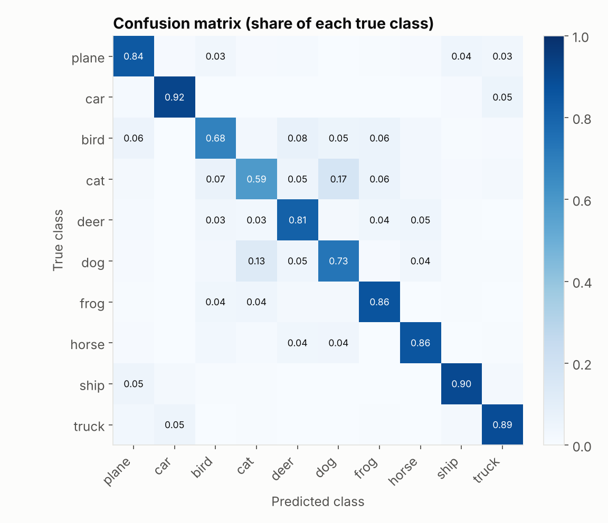
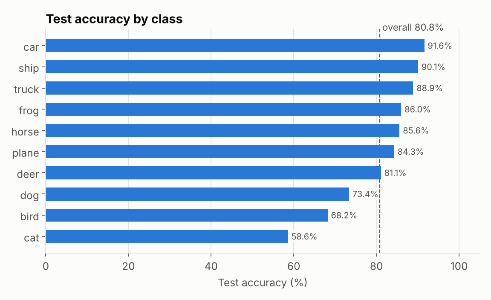
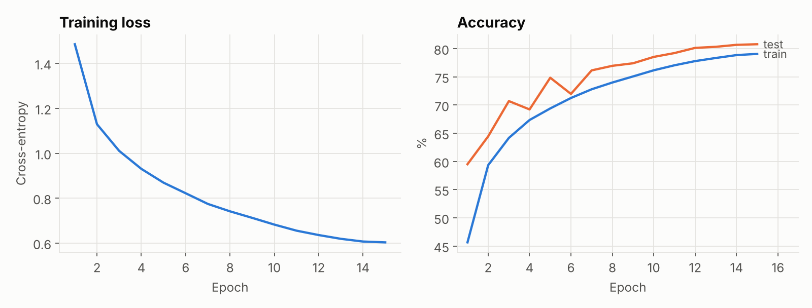

# Image Classifier (CNN, CIFAR-10)

A convolutional neural network trained from scratch in PyTorch to classify
32x32 RGB images into the 10 CIFAR-10 categories (plane, car, bird, cat, deer,
dog, frog, horse, ship, truck).

## Results

**80.8% test accuracy** on the 10,000 CIFAR-10 test images after 15 epochs,
with a 620,810-parameter network. The test set is only used for reporting: the
saved model is the one after the last epoch, not the epoch that scored best on
test.



The weakest classes are the animals that look alike at 32x32 pixels. Cats
reach 58.6% and are most often predicted as dogs (17% of cat images), and dogs
are predicted as cats 13% of the time. Vehicles are the easiest (car 91.6%,
ship 90.1%, truck 88.9%).





Test accuracy sits above training accuracy throughout because the training
numbers are measured on augmented images with dropout active, while test
images are clean and the network runs in evaluation mode.

| File | Contents |
|---|---|
| `results/metrics.json` | Overall and per-class test accuracy |
| `results/training_log.csv` | Loss, train accuracy and test accuracy per epoch |
| `results/*.png` | The figures above |

## Architecture

Three convolutional blocks (Conv2d, BatchNorm, ReLU, MaxPool) with 32, 64 and
128 channels, followed by a fully connected head (256 units, dropout 0.3). See
`model.py`.

## Setup

```bash
pip install -r requirements.txt
```

## Train

```bash
python train.py --epochs 15 --batch-size 128 --lr 1e-3 --seed 0
```

CIFAR-10 is downloaded automatically on first run. If you already have it as
image folders (`train/<class>/*.png` and `test/<class>/*.png`, as in the copy
hosted by Ultralytics), point to it instead:

```bash
python train.py --image-folder path/to/cifar10 --seed 0
```

The reported run used Adam (lr 1e-3) with a cosine schedule, random crops
and horizontal flips, on CPU (about 100 seconds per epoch on 2 cores). The
model is saved to `classifier.pt` and the per-epoch log to
`training_log.csv`.

## Evaluate

```bash
python evaluate.py --checkpoint classifier.pt --log training_log.csv --out-dir results
```

Writes the metrics file and figures in `results/`.

## Predict

```bash
python predict.py path/to/image.jpg --checkpoint classifier.pt --top-k 3
```

Prints the top-k predicted classes with their probabilities.

## Files

- `model.py`: CNN architecture (`SimpleCNN`)
- `train.py`: training loop, data augmentation, logging
- `evaluate.py`: test metrics, confusion matrix and training curves
- `predict.py`: inference on a single image
- `requirements.txt`: dependencies
