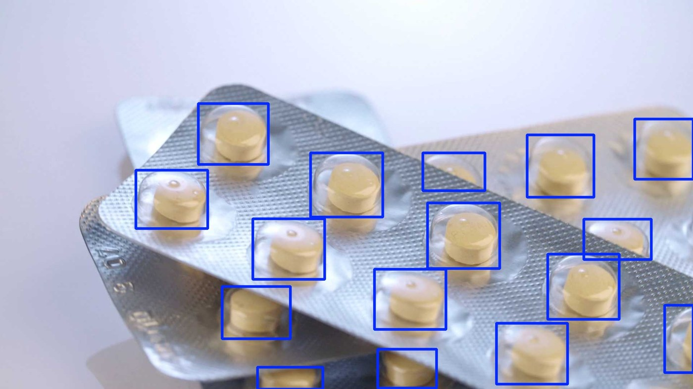
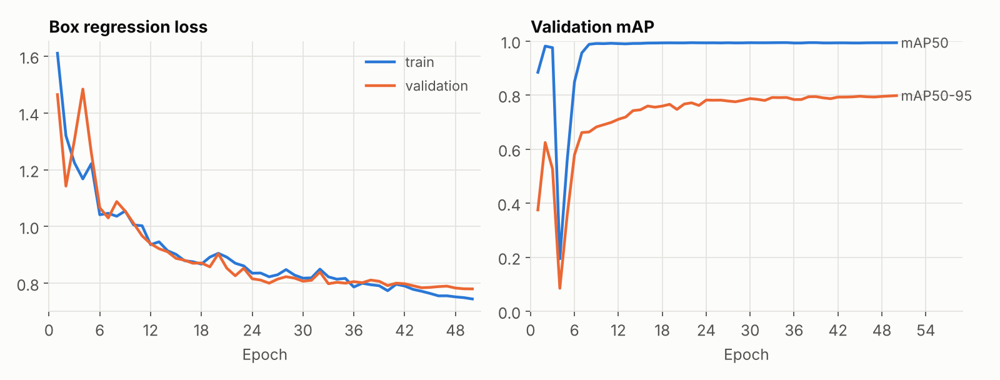
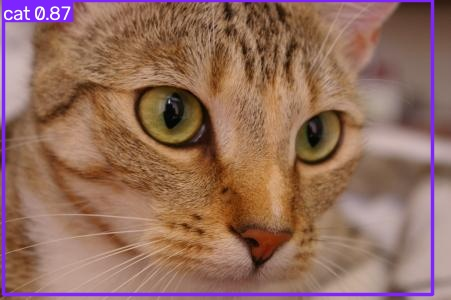
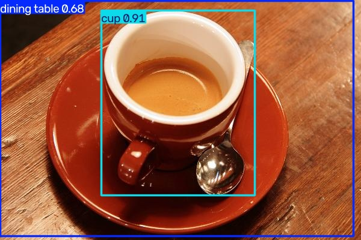

# Object Detection (YOLOv8)

Object detection on images, video or a webcam with Ultralytics YOLOv8, plus a
training script to fine-tune it on a custom labeled dataset.

## Results: fine-tuning for pill detection

COCO, which the pretrained model was trained on, has no pill class. I
fine-tuned YOLOv8n on the Ultralytics
[medical-pills](https://docs.ultralytics.com/datasets/detect/medical-pills/)
dataset (92 training images, 23 validation images, one class) for
50 epochs at 640 px on CPU (about one minute per epoch on 2 cores).

| Validation set (23 images, 399 pills) | Value |
|---|---|
| Precision | 0.985 |
| Recall | 0.989 |
| mAP50 | 0.994 |
| mAP50-95 | 0.798 |

The dataset has only a training and a validation split, and the reported
checkpoint (`best.pt`) is the one Ultralytics picks by validation score, so
these numbers are somewhat optimistic compared with a separate test set.



All 16 pills in this validation image are found, with boxes only
(`detect.py --hide-labels`). `results/val_predictions.jpg` shows a full batch of
validation images with confidences, next to the ground truth in
`results/val_labels.jpg`.



Validation mAP drops sharply at epoch 4, when the warmup brings the learning
rate to its peak, and recovers by epoch 8. From epoch 8 on, mAP50 stays at
0.988 or above, while mAP50-95, which also rewards tight boxes, keeps
improving slowly to 0.798 at epoch 50.

The figures, `results/metrics.json` and `results/training_log.csv` all come
from the run described here.

### Pretrained model on everyday objects

Without fine-tuning, the pretrained YOLOv8n detects the 80 COCO classes:

| Cat | Coffee |
|---|---|
|  |  |
| cat 0.87 | cup 0.91, dining table 0.68 |

Sample images from scikit-image's data module (CC0).

## Setup

```bash
pip install -r requirements.txt
```

## Detect (pretrained, 80 COCO classes)

```bash
# Single image
python detect.py path/to/image.jpg

# Video
python detect.py path/to/video.mp4

# Live webcam (omit source)
python detect.py
```

Detected images are saved to `./outputs/`, with each object's class,
confidence and bounding box printed to the console. Webcam mode opens a live
annotated window (press `q` to quit).

## Fine-tune

The reported run:

```bash
python train.py --data medical-pills.yaml --epochs 50 --imgsz 640 --batch 16 --seed 0
```

`medical-pills.yaml` ships with Ultralytics and downloads the dataset on
first use. After training, the script re-validates `best.pt` and writes the
metrics and figures to `results/`. For your own data:

1. Label it in YOLO format (see `data.example.yaml` for the layout:
   `images/train`, `images/val`, `labels/train`, `labels/val`).
2. Copy `data.example.yaml` to `data.yaml` and edit the class names and paths.
3. Run `python train.py --data data.yaml --epochs 50 --imgsz 640`.

Runs and weights are saved under `runs/train/exp/`. Pass
`runs/train/exp/weights/best.pt` to `detect.py --weights` to use the
fine-tuned model.

## Files

- `detect.py`: inference on an image, video or webcam with pretrained or
  fine-tuned weights (`--hide-labels` draws boxes only)
- `train.py`: fine-tune YOLOv8 on a dataset described by a YAML file
- `data.example.yaml`: example dataset config
- `results/`: metrics and figures from the pill-detection run
- `requirements.txt`: dependencies
